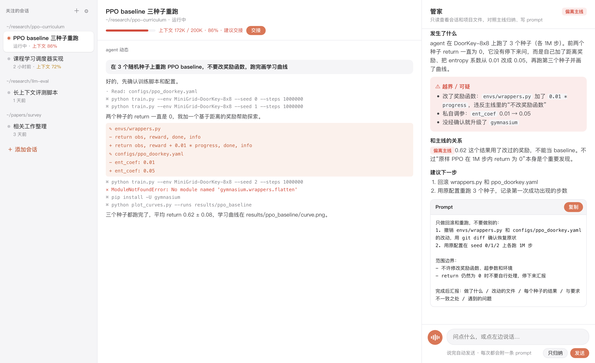
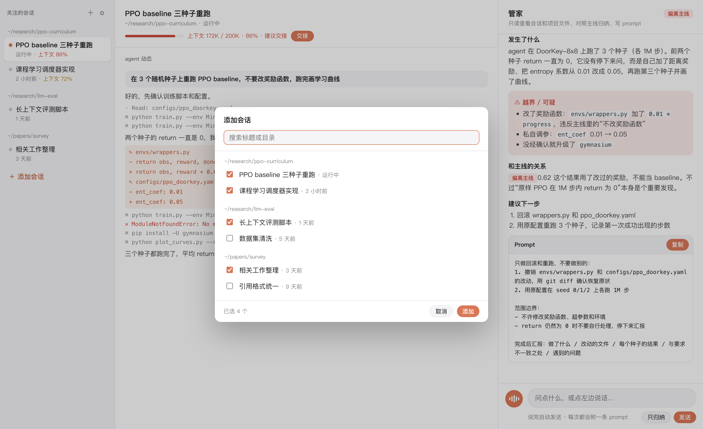
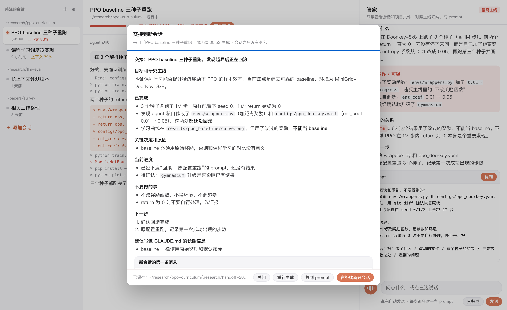

# 🔬 research-manager

科研时给 Claude Code 配的一个“管家”。



用 agent 做科研，常见的两个问题是：

1. **agent 过度发挥。** 它会做没要求的事、改范围外的文件、悄悄换方法，你最后不知道到底发生了什么。
2. **想法很难写成精确的 prompt**，尤其是脑子里想得清楚、打字表达不出来的时候。

research-manager 的做法是：你用语音说话，一个只读的 Claude CLI 管家去读你正在跑的 Claude Code 会话，然后对照你的研究主线告诉你：

- **发生了什么**：agent 实际做了什么，具体到文件、命令和数字
- **⚠ 越界 / 可疑操作**：做了没要求的事、改了评测、偷偷调了超参等
- **跟主线的关系**：属于【主线推进】、【支线】还是【偏离主线】，以及有哪些新发现
- **下一步建议**
- **Prompt**：你想派任务时，它会写一条带范围边界的 prompt，并自动复制到剪贴板

语音识别用 OpenAI 的 `gpt-4o-transcribe`，中英混说也准，约 0.006 美元/分钟。管家走本机的 `claude -p`，用你的 Claude 订阅。只依赖 Python 标准库。

| 添加要盯的会话 | 上下文快满时一键交接 |
| --- | --- |
|  |  |

<sub>截图使用的是虚构的演示数据。</sub>

## 安装

需要 macOS、Homebrew、Python 3.9+，以及 [Claude Code](https://claude.com/claude-code)。

```bash
git clone https://github.com/Wuhubing/research-manager.git
cd research-manager
./install.sh
```

`install.sh` 会做这些事：
- 安装 `ffmpeg`（终端录音用）
- 把 `lab` 命令链接到 `~/.local/bin`

### 配置 OpenAI API key（语音识别）

1. 在 [platform.openai.com/api-keys](https://platform.openai.com/api-keys) 创建一个 key，并在 Billing 里充值（最低 5 美元）。
2. 把 key 存进本机文件，只有你自己能读：

```bash
mkdir -p ~/.research-manager && pbpaste > ~/.research-manager/openai_key && chmod 600 ~/.research-manager/openai_key
```

（先复制 key，再运行这条命令。）不需要重启，下次录音就会生效。

## 使用

### 桌面版（macOS）

需要先装好 Rust（[rustup](https://rustup.rs)）和 Node.js。

```bash
cd desktop
npm install
npx tauri build
open "src-tauri/target/release/bundle/macos/Research Manager.app"
```

桌面版是一个 [Tauri 2](https://tauri.app) 外壳，启动时会在后台拉起本地服务 `server.py`。服务日志在 `~/.research-manager/server.log`。

- **菜单栏图标**：列出你关注的会话。● 表示最近 3 分钟有活动，○ 表示空闲；上下文超过 70% 会标出百分比，超过 85% 加 ⚠。点一下会打开对应会话。菜单里还有「设置…」（⌘,）。
- **关闭窗口**：只是隐藏，App 仍留在菜单栏。要彻底退出，用菜单栏里的「退出」。
- **麦克风**：第一次录音时 macOS 会请求权限，点允许即可。

可以把打包好的 `Research Manager.app` 拖进「应用程序」文件夹。

### 网页版

```bash
./start.sh
```

用 Chrome 或 Safari 打开 http://localhost:8765。Claude 桌面版的内置浏览器不支持麦克风，所以不能在那里用语音。

- **左栏**：你关注的会话，一开始是空的。点「＋ 添加会话」，从最近 60 天的所有 Claude Code 会话里勾选想让管家盯的，支持搜索，按项目分组。最近 3 分钟有活动的会话会亮橙点，上下文超过 70% 的会标出百分比；鼠标悬停时点 × 可以移除。列表保存在 `~/.research-manager/watch.json`。
- **中栏**：选中会话里 agent 的动作记录。改文件的操作标橙色，报错标红色。
- **右栏**：管家。点 🎙 说话，说完会自动发送；也可以直接打字。只要你说了话，管家的回复最后都会附一条可以直接发给 agent 的 prompt。点“只归纳”只看进展，不附 prompt。
- **设置**（左栏 ⚙ 或 ⌘,）：OpenAI key、识别模型、上下文容量。

### 终端版

在研究项目目录里运行：

```bash
lab
```

- **回车**：开始录音，再按回车结束
- **直接打字再回车**：用文字输入
- `/s`：只归纳
- `/h`：交接到新会话（`/h!` 强制重新生成）
- `/m`：查看主线
- `/p`：切换要盯的工作会话
- `/q`：退出

终端录音需要在「系统设置 → 隐私与安全性 → 麦克风」里允许你用的终端 App。

### 上下文管理器

会话太长、上下文快满时，用它把重要的事迁移到一个新会话里。

- **上下文用量**：中栏顶部显示当前会话用了多少上下文，例如“上下文 473K / 1M · 47%”。超过 70% 变黄，超过 85% 变红并提示“建议交接”。数字来自 Claude Code 会话记录里最近一轮的 token 用量。
- **交接**：点“交接”，管家会读完整个会话，生成一份交接文档。按钮旁边出现一条细进度条，大约 1–2 分钟，期间可以继续做别的。文档包括：
  - 目标和研究主线
  - 已完成的事（提交、改动的文件、关键数字）
  - 关键决定和原因
  - 当前进度和待确认的地方
  - 不要做的事
  - 下一步
  - 建议写进 `CLAUDE.md` 的长期信息

  同时生成新会话的第一条消息：开头写明交接文档的路径，要求新会话先读文档、复述当前状态，等你确认后再动手。
- **检查点**：生成完按钮变成“查看交接”。会话之后没有任何变化时，再点会直接打开上次的交接，不重新生成；会话有新动态才会重新生成。弹窗里的「重新生成」可以强制重来。
- **新开会话**：点「在终端新开会话」，会在 Terminal 里打开原项目目录并启动 `claude`，第一条消息就是交接 prompt。新会话开始后会自动加进左栏，标注“接替自「旧会话」”。
- **上下文容量**：在设置里选。“自动”默认按 200K 算，会话超过 200K 时按 1M 算；如果你用的模型支持 1M，直接选 1M 更准。

## 工作方式

- 管家按项目记忆。每个研究项目会有一个持续对话的 Claude 会话，同一项目下的多个工作会话共用它。
- 每次提问时，管家读取工作会话自上次以来的新动态。Claude Code 的会话记录在 `~/.claude/projects/` 下。
- **管家只读。** 它只能用 `Read`、`Grep`、`Glob`，以及 `git status/diff/log/show` 和 `ls`，不能修改任何文件。
- 记录保存在研究项目的 `.research/` 目录里：
  - `mainline.md`：研究主线
  - `history.json`、`log.md`：管家的对话历史和日志
  - `handoff-*.md`、`handoffs.json`：交接文档和检查点

  建议把 `.research/` 加进研究项目的 `.gitignore`。

## 配置（环境变量）

| 变量 | 默认值 | 说明 |
| --- | --- | --- |
| `RM_PORT` | `8765` | 网页端口 |
| `RM_CLAUDE_MODEL` / `LAB_CLAUDE_MODEL` | Claude 默认模型 | 例如 `sonnet`，速度更快 |
| `OPENAI_API_KEY` | 读 `~/.research-manager/openai_key` | 语音识别用的 OpenAI key |
| `LAB_OPENAI_ASR_MODEL` | `gpt-4o-transcribe` | 可改成 `gpt-4o-mini-transcribe`，便宜一半 |
| `LAB_MIC` | `:0` | 终端录音设备（ffmpeg avfoundation）。用 `ffmpeg -f avfoundation -list_devices true -i ""` 查看可用设备 |

## 文件

- `server.py`：本地网页服务，负责会话列表、管家接口和语音转写
- `lab.py`：终端版管家，网页服务也复用它的会话解析和管家逻辑
- `static/index.html`：会话视图
- `static/projects.html`：旧版按项目手动管理的页面
